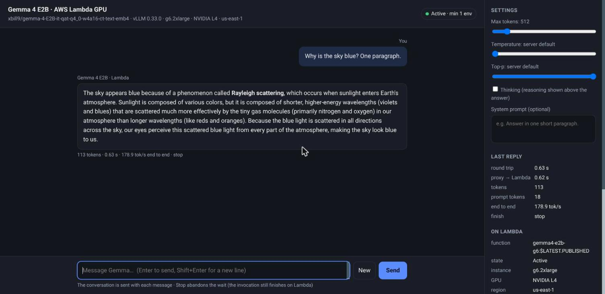

# Gemma 4 on AWS Lambda with a GPU: E2B on an NVIDIA L4, Day One

This article provides a step by step guide to serving Gemma 4 E2B from an AWS Lambda function on a GPU, using the GPU support for Lambda Managed Instances that AWS announced on 2026-11-18. The model is Google's QAT 4-bit E2B, served by vLLM on one NVIDIA L4 in a g6.2xlarge, called with `lambda invoke` and from a local chat page.

https://github.com/xbill9/gemma4-dev/tree/main/lambda-vllm-g6-2b-q4w4a16emb4

The checkpoint, vLLM version, instance type and serving flags are the ones this repo already measured on a plain EC2 G6. What changes is who runs the machine: Lambda starts it, loads the container, health-checks the server and routes every request. Every figure below was measured on 2026-11-18 and 2026-11-19 in us-east-1.

---

#### What Is New in Lambda

Until this release a Lambda function ran on CPUs. Lambda Managed Instances already ran functions on EC2 instances that Lambda manages in your account; the new part is G-series GPU instances:

| Family | GPU | GPU memory |
| :--- | :--- | :--- |
| G4dn | NVIDIA T4 | 16 GB |
| G5 | NVIDIA A10G | 24 GB |
| G6, Gr6 | NVIDIA L4 | 24 GB |
| G6e | NVIDIA L40S | 48 GB |
| G6f, Gr6f | part of an L4 | 3, 6 or 12 GB |

What comes with it, from AWS's documentation:

- One GPU per execution environment, requested with `AcceleratorConfig.AcceleratorMemorySize` (3 to 48 GB, a minimum)
- Container images up to 32 GB, against 10 GB for other functions, and up to 32,768 MB of `/tmp`
- Lambda installs and maintains the NVIDIA driver, and publishes base images for vLLM, SGLang and PyTorch
- Up to 48 requests at once per execution environment, all sharing one copy of the model
- The model loads when a version is published, before the first request
- Billing at the EC2 On-Demand price, plus a management fee of 9.75% for G-series and $0.20 per million requests, with no charge for duration

---

#### At This Point You Should Have…

- An AWS account with the AWS CLI v2 (2.41 here; boto3 1.43 has no `AcceleratorConfig` yet)
- A quota for "Running On-Demand G and VT instances" in your region: it starts at 0 vCPUs, and one g6.2xlarge needs 8
- Docker with `buildx`
- Python 3 with `huggingface_hub` and `boto3`
- A clone of `gemma4-dev`, or just the `lambda-vllm-g6-2b-q4w4a16emb4` directory

---

#### Step 1 — Read the Base Image

AWS's vLLM image is `public.ecr.aws/lambda/deep-learning-containers/vllm`. The rig pins it by digest, and its build history says what is inside:

| | Value |
| :--- | :--- |
| vLLM | 0.33.0 |
| CUDA | 13.0.3 |
| Python | 3.13 |
| Built | 2026-11-16 |
| Size | 9.13 GB compressed, 30 layers |

vLLM 0.33.0 is the version this repo's 3050 and G6 vLLM rigs serve Gemma 4 E2B with, so the checkpoint loads without patches.

The image runs two things. An engine extension starts `vllm serve` on `127.0.0.1:8000` while Lambda initialises the environment, and replaces the environment if `/health` fails. A small handler forwards each invocation's payload, unchanged, to `/v1/chat/completions` when it has `messages`. Serving flags go in one environment variable, `VLLM_SERVER_ARGS`, which the extension splits with `shlex.split`.

---

#### Step 2 — Bake the Model into the Image

The checkpoint is `xbill9/gemma-4-E2B-it-qat-q4_0-w4a16-ct-text-emb4`: Google's QAT Q4_0 weights in compressed-tensors W4A16, with the vocabulary tables at 4 bits too, text only. At 2,862,925,039 bytes it fits in the image, so the instance needs no access to Hugging Face or S3:

```dockerfile
ARG BASE_IMAGE
FROM ${BASE_IMAGE}
COPY model/ /opt/model/
ENV MODEL_ID=/opt/model
COPY drafter/ /opt/drafter/
```

`make model` downloads the checkpoint at a pinned revision. `make image` builds and pushes it to ECR:

```bash
docker buildx build --platform linux/amd64 --provenance=false --sbom=false \
  --build-arg BASE_IMAGE=public.ecr.aws/lambda/deep-learning-containers/vllm@sha256:3272913a... \
  -t ACCOUNT.dkr.ecr.us-east-1.amazonaws.com/lambda-vllm-g6-2b-q4w4a16emb4:db715f83da4f \
  --output type=image,oci-mediatypes=false,push=true image/
```

The flags matter. `CreateFunction` accepts a single-platform Docker v2 manifest and refuses an OCI image index, which Docker 29 pushes by default with a provenance attestation ("The image manifest, config or layer media type … is not supported"). The first push, base layers included, took 398.4 s from a home connection; a rebuild that only adds a layer pushed in 19.6 s.

---

#### Step 3 — Two Roles and a Capacity Provider

A capacity provider tells Lambda which instances to run and where. It needs an operator role that Lambda assumes to launch them:

```bash
make roles      # lambda-lmi-gpu-operator (AWSLambdaManagedEC2ResourceOperator)
                # lambda-lmi-gpu-exec     (AWSLambdaBasicExecutionRole)
make provider
```

`lmi.py` sends this to `aws lambda create-capacity-provider`, with the default VPC's subnets and security group:

```json
{
  "CapacityProviderName": "gemma4-e2b-g6",
  "VpcConfig": {"SubnetIds": ["subnet-..."], "SecurityGroupIds": ["sg-..."]},
  "PermissionsConfig": {"CapacityProviderOperatorRoleArn": "arn:aws:iam::ACCOUNT:role/lambda-lmi-gpu-operator"},
  "InstanceRequirements": {"Architectures": ["x86_64"], "AllowedInstanceTypes": ["g6.2xlarge"]},
  "CapacityProviderScalingConfig": {"ScalingMode": "Auto", "MaxVCpuCount": 16}
}
```

Allowing only `g6.2xlarge` keeps the hardware the same as the EC2 G6 measurements. `MaxVCpuCount` 16 matches this account's G quota: two instances at most.

---

#### Step 4 — Create the Function

`make function` creates it from the image. The GPU parts are `AcceleratorConfig` and `CapacityProviderConfig`:

```json
{
  "FunctionName": "gemma4-e2b-g6",
  "PackageType": "Image",
  "MemorySize": 16384,
  "Timeout": 900,
  "EphemeralStorage": {"Size": 10240},
  "AcceleratorConfig": {"AcceleratorMemorySize": 16},
  "CapacityProviderConfig": {"LambdaManagedInstancesCapacityProviderConfig": {
    "CapacityProviderArn": "arn:aws:lambda:us-east-1:ACCOUNT:capacity-provider:gemma4-e2b-g6",
    "PerExecutionEnvironmentMaxConcurrency": 48,
    "ExecutionEnvironmentMemoryGiBPerVCpu": 4.0}},
  "Environment": {"Variables": {
    "MODEL_ID": "/opt/model",
    "SERVED_MODEL_NAME": "xbill9/gemma-4-E2B-it-qat-q4_0-w4a16-ct-text-emb4",
    "VLLM_GPU_MEM_UTIL": "0.85",
    "VLLM_MAX_MODEL_LEN": "16384",
    "VLLM_SERVER_TIMEOUT": "840",
    "VLLM_SERVER_ARGS": "--max-num-seqs 64 --language-model-only --enable-auto-tool-choice --tool-call-parser gemma4 --reasoning-parser gemma4 --speculative-config '{\"model\": \"/opt/drafter\", \"num_speculative_tokens\": 4}'"}}
}
```

16 GiB at 4 GiB per vCPU asks for 4 of the g6.2xlarge's 8 vCPUs. `PerExecutionEnvironmentMaxConcurrency` 48 is the most Lambda allows, and vLLM batches whatever arrives. The serving values are the EC2 G6 rig's.

---

#### Step 5 — Publish, and Set the Environments

An unpublished function reports `ActiveNonInvocable`. Publishing starts the environments and loads the model, and the version turns `Active` when vLLM answers:

```bash
aws lambda publish-version --function-name gemma4-e2b-g6 --publish-to LATEST_PUBLISHED
aws lambda put-function-scaling-config --function-name gemma4-e2b-g6 \
  --qualifier '$LATEST.PUBLISHED' \
  --function-scaling-config '{"MinExecutionEnvironments": 1, "MaxExecutionEnvironments": 1}'
```

Lambda's default is 3 environments across Availability Zones; at 8 vCPUs per g6.2xlarge that is 3 × 8 = 24 vCPUs of G quota (arithmetic). One is enough for a demo.

The first publish took 484.0 s to `Active`. vLLM printed its banner 312 s after the publish. That time covers launching the instance and fetching the image (9.13 GB of base layers plus the 2.86 GB checkpoint), which Lambda does not time separately. Lambda's init for the environment then took 156,397 ms, of which vLLM's own log shows:

| Step | Time |
| :--- | :--- |
| Load 2.85 GiB of weights | 5.64 s |
| `torch.compile` | 43.54 s |
| Engine init (profile, KV cache, warmup) | 64.94 s |

vLLM reports `Using MarlinLinearKernel for CompressedTensorsWNA16` and 1,593,517 tokens of KV cache in 14.28 GiB.

---

#### Step 6 — Call It

`make ask` sends one chat completion through `aws lambda invoke`:

```bash
$ make ask Q="In two sentences, what is AWS Lambda?"
AWS Lambda is a serverless compute service that lets you run code without provisioning
or managing servers. It automatically scales your code based on demand, allowing you to
focus on writing and deploying your application logic.

18 in / 41 out, 2.41 s round trip (aws cli start-up included)
```

The payload is an OpenAI chat request, so everything vLLM accepts passes through: `chat_template_kwargs.enable_thinking` turns on Gemma's thinking, and the reasoning comes back in `reasoning`. The reply arrives whole: Lambda returns the completion when it is finished, with no stream.

---

#### Step 7 — A Local Chat Page

`chat_ui.py` is this repo's chat page, from the TPU v5e vLLM rig by way of the AMD Token Lab rig. Its local proxy turns each chat request into a synchronous boto3 `Invoke` with your AWS credentials, so the browser talks only to `localhost`:

```bash
$ make ui
Chat UI on http://localhost:8768 -> Lambda gemma4-e2b-g6:$LATEST.PUBLISHED in us-east-1
```



The side panel shows the version's state and its environments, the rig's settings, and each reply's round trip and tokens. With no stream, speed is completion tokens over the whole round trip: the reply above, 113 tokens, took 0.63 s.

---

#### Step 8 — Add Google's Drafter

Gemma 4 has assistant drafters: small models that guess the next few tokens for the main model to check in one step. `repack/repack_drafter.py` rebuilds Google's E2B QAT assistant as W4A16, 143 MB, and the Dockerfile copies it to `/opt/drafter`. One flag turns it on:

```bash
--speculative-config '{"model": "/opt/drafter", "num_speculative_tokens": 4}'
```

The serving environment's log confirms it: `speculative_config=SpeculativeConfig(method='mtp', model='/opt/drafter', num_spec_tokens=4)`, 2.98 GiB of weights with the drafter and 1,486,429 tokens of KV cache.

---

#### Step 9 — How Fast Is It?

`bench.py` sends 1, 4, 16 and 48 synchronous invokes at once from a desktop to us-east-1. Each asks for 256 tokens with `ignore_eos`, greedy, thinking off, with a unique prefix so vLLM's prefix cache cannot help. Times include the round trip and Lambda's invoke path. Every request was matched to the serving environment's log stream:

| Requests at once | No drafter | With drafter | Drafter / none |
| :--- | :--- | :--- | :--- |
| 1 | 126.8–133.4 tok/s | 212.8–224.3 tok/s (69.3 first) |  1.63x |
| 4 | 306.7–497.3 | 723.2 (386.3 first) |  1.47x |
| 16 | 1,640.9–1,738.9 | 1,510.5–1,515.3 | 0.88x |
| 48 | 3,441.8–3,614.4 | 2,249.1–2,266.8 | 0.63x |

Ratios are of the medians, first requests included. "First" is the first request or batch on a new environment: the first drafter request took 3.69 s. After it, one 256-token reply came back in 1.14–1.20 s with the drafter, against 1.92–2.02 s without it. All 417 requests succeeded, and one environment took all 48 at once.

The drafter pays with up to 4 requests at once and costs throughput from 16. vLLM's log over the run shows 1.64–2.13 tokens accepted per step and 15.9–28.3% of drafted tokens accepted. On this repo's EC2 G6, the same drafter build at 4 tokens paid at every level up to 64 requests, measured with different prompts, streamed and timed on the instance; why it loses here from 16 requests is not established.

---

####  Tip: Set Both Limits, and Republish from Zero

Set `MinExecutionEnvironments` and `MaxExecutionEnvironments` together. Lambda resets the one you leave out to its default, and with no maximum it added a second g6.2xlarge under the 48-request load.

A republish starts the new environment before it stops the old one. At the capacity provider's vCPU limit the update ends `Failed` with "MinimumExecutionEnvironments can't be provisioned because CapacityProvider has reached maxVCpuCount limit", and `$LATEST.PUBLISHED` keeps the previous image and settings. The rig's `republish.py` scales to 0, publishes, scales back to 1 and prints vLLM's engine line, so you can see the settings the new environment started with. From scaling up to `Active` took 552 s.

`make down` sets both limits to 0 and releases the instance; `make up` brings it back.

---

#### Compare and Contrast

The same model, vLLM version and L4, run three ways in this repo:

| | Lambda GPU function | EC2 G6 instance | RTX 3050 at home |
| :--- | :--- | :--- | :--- |
| Who runs the server |  Lambda: start, health, restart, routing | you | you |
| How you call it | `lambda invoke`, or any Lambda trigger | HTTP to the instance | HTTP on localhost |
| Streaming | none through the standard handler |  yes |  yes |
| Start-up | 484–552 s to `Active` | an EC2 launch plus your setup |  none |
| Cost while idle | EC2 price plus 9.75%, or 0 at zero environments | EC2 price, or stopped |  power only |
| Scaling |  by GPU use, CPU use or concurrency, to zero | Auto Scaling groups | one card |

---

#### So, Which One?

For a model behind events, queues or other AWS services, the Lambda GPU function is the simpler road: one image, one function, and Lambda keeps the server alive and routes the requests. Keep the drafter on for a chat with a few users at a time, and publish without it for heavy batch load.

When you need streamed replies or full control of the server, run vLLM on an EC2 G6 yourself.

---

#### Summary

The goal of this article was to serve Gemma 4 E2B from an AWS Lambda function on a GPU on the day the feature launched. The key to the solution was AWS's vLLM base image with the 4-bit checkpoint and Google's drafter baked in, one g6.2xlarge behind a capacity provider, and a local proxy for the chat page. The results were:

- Gemma 4 E2B serves from Lambda on an NVIDIA L4, from AWS's vLLM 0.33.0 image, with the 4-bit QAT checkpoint and no patches.
- One environment took 48 requests at once: 3,614.4 output tokens per second at best, with no failed request in 417.
- Google's drafter made a single reply 1.63x faster: 256 tokens in 1.14–1.20 s against 1.92–2.02 s.
- A local chat page calls the function with your own AWS credentials.
- The drafter costs throughput from 16 requests at once: 0.63x at 48.
- Publishing takes about 8–9 minutes before the first answer, and the instance bills while the minimum is above 0.
- Replies arrive whole: the standard handler has no stream, so time to first token cannot be measured or shown.
- A republish at the vCPU limit fails and keeps the old version; scale to 0 first.

Scope: one g6.2xlarge in us-east-1, one execution environment, AWS's vLLM image built 2026-11-16, measured 2026-11-18 and 2026-11-19 from a desktop in the US. Throughput is short prompts and 256 output tokens; long prompts, answer accuracy and thinking-on load were not measured. The drafter used 4 drafted tokens only.

The strategy for serving Gemma 4 on a Lambda GPU function was validated with an incremental step by step approach.

---

#### References

- [lambda-vllm-g6-2b-q4w4a16emb4 on GitHub](https://github.com/xbill9/gemma4-dev/tree/main/lambda-vllm-g6-2b-q4w4a16emb4)
- [Evidence for this article](https://github.com/xbill9/gemma4-dev/tree/main/docs/gemma4-e2b-lambda-gpu/evidence)
- [AWS Lambda now supports GPU instances for Event Functions on Lambda Managed Instances](https://aws.amazon.com/blogs/aws/aws-lambda-now-supports-gpu-instances-for-event-functions-on-lambda-managed-instances/)
- [Run GPU-accelerated Event Functions on Lambda Managed Instances](https://docs.aws.amazon.com/lambda/latest/dg/lambda-managed-instances-gpu.html)
- [Lambda GPU base images](https://docs.aws.amazon.com/lambda/latest/dg/lambda-managed-instances-gpu-base-images.html)
- [Lambda Managed Instances scaling](https://docs.aws.amazon.com/lambda/latest/dg/lambda-managed-instances-scaling.html)
- [AWS Lambda pricing](https://aws.amazon.com/lambda/pricing/)
- [Six Serving Engines on One EC2 G6](https://dev.to/aws-builders/six-serving-engines-on-one-ec2-g6-gemma-4-e2b-on-an-nvidia-l4-3ff3)
- [gemma-4-E2B-it-qat-q4_0-w4a16-ct-text-emb4 on Hugging Face](https://huggingface.co/xbill9/gemma-4-E2B-it-qat-q4_0-w4a16-ct-text-emb4)
- [vLLM](https://github.com/vllm-project/vllm)
- [gemma4-dev on GitHub](https://github.com/xbill9/gemma4-dev)

Hope you enjoyed it!
