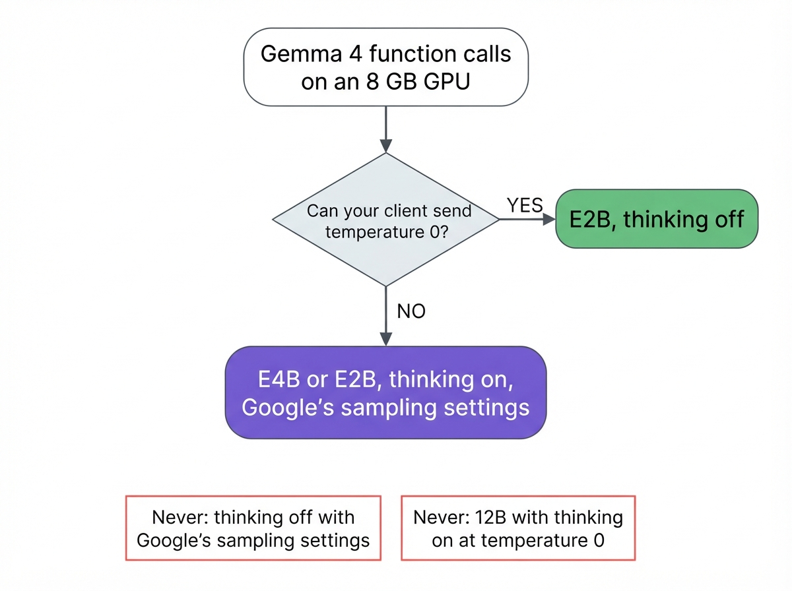

On an 8 GB card, the setting decides function calling more than the model size does. With Google's sampling settings and thinking off, E4B answers 1 tool request in 9 in prose; with thinking on, 1 in 100. With the setting right, E2B, E4B and the 12B are level on 840 problems, and E2B does the job in a quarter of the 12B's time.

Thinking off under Google's settings cost E4B 60 problems (p = 1.1e-8) and E2B 46; thinking on won them back. At temperature 0 with thinking off the three scored 748, 758 and 756 of 840; with Google's settings and thinking on, 751, 761 and 751; no step up in size is beyond chance. The 12B gets more single calls right and calls a tool more often when none fits, and overall is level with E4B (p = 0.904).

If your client sends temperature 0, serve E2B with thinking off. If it runs Google's settings, turn thinking on, on E4B or E2B. Never combine Google's settings with thinking off, and never run the 12B with thinking on at temperature 0. Each setting ran once.

This article provides a step by step comparison of function calling with three Gemma 4 models on one local GPU: E2B, E4B and 12B, each as a 4-bit QAT build on an 8 GB RTX 3050 through llama.cpp. Each model answered 840 problems from the Berkeley Function Calling Leaderboard four ways: at temperature 0 and with Google's sampling settings, each with thinking off and on.

https://github.com/xbill9/gemma4-dev/tree/main/docs/gemma4-function-calls-3050

---

#### The Decision Flow

Answer one question, and avoid two combinations.

1. **Can your client send temperature 0?** Use **E2B with thinking off**: 748 of 840 right in 0.84 seconds per problem. E4B (758) and the 12B (756) are level with it on a paired test (p = 0.26 and p = 0.416) and take 1.98 and 4.23 times as long.
2. **Otherwise**, with Google's settings, use **E4B or E2B with thinking on**: 761 and 751 of 840, level with each other (p = 0.275); E4B takes 1.33 times as long.
3. **Never thinking off with Google's settings.** E4B drops to 698, beyond chance below its own 758 at temperature 0 (p = 1.1e-8).
4. **Never the 12B with thinking on at temperature 0.** It drops to 735 against 756 with thinking off (p = 0.0154), and 19 of its replies ran to the 8,192-token limit.

---

#### The Findings

**With Google's settings and thinking off, the small models skip the call.** On the 600 problems where one of the offered tools fits, E4B made no call in 66 replies, against 22 at temperature 0. It answered "3 to the power of 4" itself instead of calling `math_power`, and asked for a growth rate the question left to the tool's default. At temperature 0 E4B called the tool correctly on each of those problems. E2B went from 11 replies with no call to 39.

**Thinking switched off, E4B thinks anyway.** With Google's settings and thinking off, 496 of E4B's 840 replies and 138 of E2B's carried thinking text; the 12B's carried none. The thinking helps: E4B was right on 456 of the 496 replies that thought and 242 of the 344 that did not. At temperature 0 no reply with thinking off carried any.

**Thinking on fixes it.** With Google's settings, thinking on against off: E4B +97 / −34 (p = 3.32e-8), E2B +81 / −32 (p = 4.55e-6). E4B's replies with no call fell from 66 to 6.

**Get the setting right and size stops mattering.** At temperature 0 with thinking off: 748, 758 and 756 of 840. With Google's settings and thinking on: 751, 761 and 751. No step up in size is beyond chance at either setting.

**The 12B calls tools it should not.** At temperature 0 with thinking off, the 12B beats E4B on single calls (+24 / −9, p = 0.0135) and loses on requests no tool fits, where the right reply is no call (+2 / −18, p = 0.000402). Overall the two are level (+33 / −35, p = 0.904). An earlier article on this card scored only single calls and picked the 12B for function calls; with all three kinds it holds no lead.

**What to do with it.**

- 🟢 At temperature 0, E2B with thinking off is level with the larger two at 0.24 to 0.50 times their time.
- 🟢 With Google's settings, thinking on puts E2B and E4B back level with the best scores here.
- ❌ Google's settings with thinking off cost E2B and E4B 46 and 60 problems of 840.

---

#### What Was Measured

| | E2B | E4B | 12B |
| :--- | :--- | :--- | :--- |
| Weights | exact Q4_0 repack of Google's QAT | same | same |
| Card memory when serving | 🥇 3,610 MiB | 6,430 MiB | 7,294 MiB |
| Context, cache | 131,072, f16 | 131,072, f16 | 81,920, q4_0 |

Each model answered three categories of BFCL v3, 840 problems in all, in four settings: temperature 0 and Google's settings (temperature 1.0, top-k 64, top-p 0.95, from each model's `generation_config.json`), each with thinking off and on. That is 36 runs and 10,080 replies, one request at a time, no drafter, with an 8,192-token limit on each reply, thinking included.

---

#### At This Point You Should Have…

- An NVIDIA card with 8 GB, here an RTX 3050 OEM on driver 615.78.08
- llama.cpp built with CUDA, here commit `d1044bc82`
- Python 3
- A clone of [gemma4-dev](https://github.com/xbill9/gemma4-dev)

---

#### Step 1 — Three Kinds of Function Call

Every problem offers the model one or more tools through the OpenAI `tools` field and lets it choose:

| Category | Problems | Tools offered | Right reply |
| :--- | ---: | :--- | :--- |
| Simple | 400 | 1 | one call to it with the right arguments |
| Multiple | 200 | 2 to 4 | one call to the right one with the right arguments |
| Irrelevance | 240 | 1 that fits nothing asked | no call |

Arguments are checked as BFCL's own checker does: required parameters present, nothing outside the schema, and each value among the accepted ones. The scorer is plain code, so the model never grades itself.

---

#### Step 2 — Temperature 0, Thinking Off

| | E2B | E4B | 12B |
| :--- | ---: | ---: | ---: |
| Simple, of 400 | 369 | 365 | 🥇 380 |
| Multiple, of 200 | 180 | 🥇 184 | 183 |
| Irrelevance, of 240 | 199 | 🥇 209 | 193 |
| All 840 | 748 | 🥇 758 | 756 |
| Seconds per problem | 🥇 0.84 | 1.67 | 3.57 |

The simple scores repeat October runs on this card: 369 and 365 exactly, and 380 for the 12B against 379. Paired over all 840 problems, E4B against E2B is +37 / −27 (p = 0.26) and the 12B against E2B +41 / −33 (p = 0.416).

---

#### Step 3 — Google's Settings, Thinking Off

| | E2B | E4B | 12B |
| :--- | ---: | ---: | ---: |
| All 840, temperature 0 | 748 | 758 | 756 |
| All 840, Google's settings | 702 | 698 | 🥇 740 |
| Paired, temperature 0 against Google's | +74 / −28 | +86 / −26 | +28 / −12 |
| p | 5.91e-6 | 1.1e-8 | 0.0166 |
| No call when a tool fits, of 600 | 39 | 66 | 🥇 3 |
| Replies carrying thinking, of 840 | 138 | 496 | 🥇 0 |

All three lose problems; E2B and E4B lose most, and most of what they lose is the call itself. The same four E4B problems, two ways:

| Problem | Temperature 0 | Google's settings |
| :--- | :--- | :--- |
| 3 to the power of 4 | `math_power(base=3, exponent=4)` | "3 to the power of 4 is 81" |
| Light time from a star 4 light-years away | `light_travel_time(distance_in_light_years=4)` | "Light will take 4 years to reach Earth" |
| Population in 20 years | `population_projections(...)` | "What growth rate would you like me to use?" |
| Vegan Thai restaurants in Manhattan | `find_restaurants(...)` | "I will need more specific location information" |

On the irrelevance problems Google's settings push the other way too: E2B called a tool that fits nothing in 63 of 240 replies against 41, E4B in 45 against 31.

---

#### Step 4 — Thinking On

| All 840 | E2B | E4B | 12B |
| :--- | ---: | ---: | ---: |
| Google's settings, thinking off | 702 | 698 | 740 |
| Google's settings, thinking on | 751 | 🥇 761 | 751 |
| Paired, on against off | +81 / −32 | +97 / −34 | +38 / −27 |
| p | 4.55e-6 | 3.32e-8 | 0.215 |
| Temperature 0, thinking off | 748 | 758 | 756 |
| Temperature 0, thinking on | 757 | 🥇 770 | 735 |
| Paired, on against off | +39 / −30 | +38 / −26 | +24 / −45 |
| p | 0.336 | 0.169 | 0.0154 |

With Google's settings, thinking on recovers what thinking off lost on E2B and E4B. At temperature 0 it changes nothing beyond chance on E2B and E4B and costs the 12B 21 problems: on irrelevance it called a tool in 62 of 240 replies, and 19 of them ran to the 8,192-token limit.

E4B's best score, 770 at temperature 0 with thinking on, is level with its 761 under Google's settings (+33 / −24, p = 0.289) at twice the time. With Google's settings and thinking on, E4B thought in only 290 of its 840 replies and still got 488 of the other 550 right.

---

#### Step 5 — Bigger Model, Different Mistakes

Paired by category, the 12B against E4B:

| | Simple | Multiple | Irrelevance | All 840 |
| :--- | ---: | ---: | ---: | ---: |
| Temperature 0, thinking off | +24 / −9 | +7 / −8 | +2 / −18 | +33 / −35 |
| p | 0.0135 | 1 | 0.000402 | 0.904 |
| Google's settings, thinking on | +20 / −8 | +7 / −4 | +2 / −27 | +29 / −39 |
| p | 0.0357 | 0.549 | 1.62e-6 | 0.275 |

The 12B gets more single calls right and calls a tool more often when none fits: 47 of 240 at temperature 0 with thinking off, against E4B's 31. The two errors cancel. If every request your application sends has a tool that fits, the 12B's lead is small: on the 600 problems where a tool fits, the 12B at temperature 0 with thinking off scored 563 against 549 for E4B at the same setting (+31 / −17, p = 0.0595) and 551 for E4B with Google's settings and thinking on (+29 / −17, p = 0.104), both within chance.

---

#### Step 6 — Time

Hours for all 840 problems, one request at a time:

| | E2B | E4B | 12B |
| :--- | ---: | ---: | ---: |
| Temperature 0, thinking off | 🥇 0.20 | 0.39 | 0.83 |
| Google's settings, thinking off | 0.28 | 0.77 | 0.85 |
| Google's settings, thinking on | 0.62 | 0.83 | 2.76 |
| Temperature 0, thinking on | 0.84 | 1.67 | 3.79 |

E4B with thinking on and Google's settings takes the same time as the 12B with thinking off at temperature 0 (1.00x) for a level score (+36 / −31, p = 0.625), and 0.30 times the 12B's time at the same setting.

---

#### 🔎 Tip: Count the Replies That Skip the Tool

A score hides why replies are wrong. Count the replies that should have called a tool and did not: with Google's settings and thinking off, E4B's count went from 22 to 66 of 600 while its score fell by 60. If your agent's tool calls drop after a change to sampling, check whether thinking is off before you blame the model.

---

#### Compare and Contrast

| | E2B | E4B | 12B |
| :--- | :--- | :--- | :--- |
| Temperature 0, thinking off | 748 | 🥇 758 | 756 |
| Google's settings, thinking on | 751 | 🥇 761 | 751 |
| Google's settings, thinking off | 702 | 698 | 🥇 740 |
| Seconds per problem, temperature 0, thinking off | 🥇 0.84 | 1.67 | 3.57 |
| No call when a tool fits, Google's settings, thinking off | 39 of 600 | 66 of 600 | 🥇 3 of 600 |
| Calls when no tool fits, temperature 0, thinking off | 41 of 240 | 🥇 31 of 240 | 47 of 240 |
| Card memory | 🥇 3,610 MiB | 6,430 MiB | 7,294 MiB |

**Pros and cons**

- **E2B.** 🟢 Level with the larger two at either good setting, in the least time and memory. ❌ With Google's settings and thinking off it loses 46 problems.
- **E4B.** 🟢 The highest score at both good settings, within chance of the others. 🟢 With thinking on and Google's settings, 6 replies of 600 with no call. ❌ With Google's settings and thinking off it loses 60 problems, most of them by answering in prose.
- **12B.** 🟢 The steadiest under Google's settings with thinking off, and the most single calls right. ❌ Calls a tool most often when none fits. ❌ Thinking on at temperature 0 costs it 21 problems. ❌ 4.23 times E2B's time.

---

#### So, Which One?

**Temperature 0: E2B with thinking off.** It is level with E4B and the 12B and takes 0.84 seconds per problem in 3,610 MiB.

**Google's settings: E4B or E2B with thinking on.** E4B scored 761 and E2B 751, level; take E2B for time and E4B if the same server also handles math, where an earlier run on this card put E4B ahead.

**The 12B only if every request has a tool that fits,** and then at temperature 0 with thinking off. It leads E4B on single calls (p = 0.0135) and is within chance of it on all 600 problems where a tool fits (p = 0.0595); its extra calls when nothing fits cancel the lead on a mixed load.

**Thinking: match it to the sampling.** With Google's settings, thinking on. At temperature 0, off.

---

#### Summary

The goal of this article was to find which Gemma 4 model and setting to serve for function calls on one 8 GB card. The key to the solution was scoring all three sizes on the same 840 problems in four settings, so every comparison is paired problem by problem. The results were:

- ❌ With Google's sampling settings and thinking off, E4B answered 66 of 600 tool requests in prose and lost 60 problems against temperature 0 (p = 1.1e-8); E2B lost 46.
- 🟢 Thinking on with Google's settings recovered them: E4B +97 / −34, 6 of 600 with no call.
- 🟢 At each good setting the three sizes were level: 748, 758, 756 at temperature 0 with thinking off; 751, 761, 751 with Google's settings and thinking on.
- ⚠️ The 12B wins single calls and loses on requests no tool fits; overall level with E4B (p = 0.904).
- ❌ The 12B with thinking on at temperature 0 lost 21 problems, and 19 replies ran to the token limit.
- 🟢 E2B at temperature 0 with thinking off took 0.84 seconds per problem, 0.24 times the 12B's time.

Scope: one RTX 3050 OEM with 8 GB in one desktop, llama.cpp `d1044bc82`, exact Q4_0 repacks of Google's QAT weights, one run of each setting with seed 1 for Google's settings, one request at a time, no drafter, an 8,192-token reply limit, 2026-11-23 to 24. BFCL v3 simple (400), multiple (200) and irrelevance (240), single-turn; the parallel categories and multi-turn conversations are untested. Function calls ran through llama.cpp's Gemma 4 tool-call parsing; other servers parse calls their own way. Times move with clock and temperature. The article reports 24 paired tests; corrected for that number (Holm), the losses from thinking off under Google's settings and the 12B's extra calls when no tool fits still hold, and the 12B's single-call lead and its drop with thinking on at temperature 0 do not. "Level" means no gap beyond chance: with one run of 840 problems near 90 percent, a gap smaller than about 2.9 to 4.1 percentage points does not show.

The strategy for choosing a Gemma 4 model and setting for function calls on a small GPU was validated with an incremental step by step approach.

---

#### References

- [gemma4-dev on GitHub](https://github.com/xbill9/gemma4-dev)
- [This article's evidence: scripts and outputs](https://github.com/xbill9/gemma4-dev/tree/main/docs/gemma4-function-calls-3050/evidence)
- [The run: replies, logs and results](https://github.com/xbill9/gemma4-dev/tree/main/local-llamacpp-3050oem-4b-q4_0/benchmarks/runs/2026-11-23-functions-e2b-e4b-12b-3050oem)
- [E2B, E4B or 12B? On an 8 GB RTX 3050, Serve Gemma 4 E4B](https://dev.to/gde/e2b-e4b-or-12b-on-an-8-gb-rtx-3050-serve-gemma-4-e4b-1eji)
- [The scoring script](https://github.com/xbill9/gemma4-dev/tree/main/benchmarks/gen-eval)
- [Berkeley Function Calling Leaderboard dataset](https://huggingface.co/datasets/gorilla-llm/Berkeley-Function-Calling-Leaderboard)
- [Exact Q4_0 repack of Gemma 4 12B QAT](https://huggingface.co/xbill9/gemma-4-12B-it-qat-q4_0-exact-gguf)
- [llama.cpp](https://github.com/ggml-org/llama.cpp)

Hope you enjoyed it!
