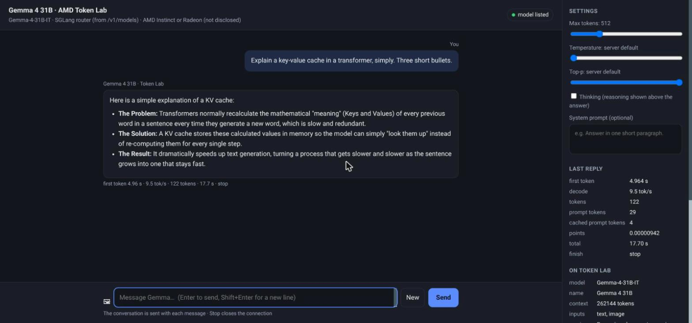

This article provides a step by step guide to calling Gemma 4 31B on AMD GPUs through AMD Token Lab, a free API that comes with membership of the AMD AI Developer Program. A local chat page, a terminal client and a small ADK agent are built on top of it, all from the same rig.

https://github.com/xbill9/gemma4-dev/tree/main/tokenlab-sglang-amd-31b

The question is simple: what can you build on an API that costs nothing? Token Lab gives every program member a key, a 30-day access period and a points budget, with no credit card and no credit request. Every figure below comes from requests sent to it on 2026-11-13.

---

#### What Is AMD Token Lab?

Token Lab describes itself as an OpenAI-compatible API "for leading open models, served on AMD Instinct and Radeon". The base URL is `https://api.tokenlab.amd.com/v1`, and it works from curl, the OpenAI and Anthropic SDKs, LangChain, and AMD AI Notebooks.

It is one of the member perks of the AMD AI Developer Program. The program's Cloud Credits page offers three options: AMD Instinct Developer Cloud, Fireworks AI, and Token Lab. Token Lab is the only one marked "No credit request needed".

The catalog held 10 models, every one marked Free: Gemma 4 31B, DeepSeek V4 Flash and V4.1 Flash, Qwen3.8 27B, three MiniCPM models, and three decision models. Gemma-4-31B-IT reads text and images and has a 262,144-token context.

What a new key came with:

| Allowance | Value |
| :--- | :--- |
| Points | 10, for the access period |
| Access period | 30 days, extendable once by 15 days |
| Rate limit | 20 requests per minute per key |
| Gemma 4 31B rate | 0.035 points per million input tokens, 0.07 per million output |
| Cost to you | nothing |

Token Lab says points measure relative usage per model, with larger models using more points per token. Running everything in this article, 23 requests used 0.000335 of the 10 points.

---

#### At This Point You Should Have…

- An email address for an AMD account
- Python 3 with `pip`
- For the agent: `google-adk` and `litellm` (`pip install google-adk litellm`)
- A clone of `gemma4-dev`, or just the `tokenlab-sglang-amd-31b` directory

---

#### Step 1 — Join the AMD AI Developer Program

The program's home page says it plainly: "The program is free to join and helps you build, optimize, and scale AI on AMD hardware."

Go to https://developer.amd.com and choose **Join the Program**. New to AMD, the steps the page lists are:

1. Complete the AMD AI Developer Program sign-up form
2. Verify your email address
3. Access AI Academy

With an existing AMD account, log in and open the join form instead.

Membership also lists a one-month DeepLearning.AI membership, early event registration, a private Discord with AMD engineers, and a monthly sweepstakes for a Radeon GPU or a Ryzen AI PC.

---

#### Step 2 — Get a Token Lab Key

Open https://notebooks.amd.com/tokenlab and sign in with **AMD AI Developer Program (Global) Login**. The page has three steps: get your key, copy the base URL, call a model from the catalog.

The dashboard shows points remaining, requests in the last 30 days, days left, the rate limit and the key's status, with buttons to regenerate or revoke the key. Regenerating keeps your points and your access period.

Put the key in the rig's `.env`, readable only by you and never committed:

```bash
cd tokenlab-sglang-amd-31b
umask 077; echo 'TOKENLAB_API_KEY=tl-...' > .env
```

The base URL and the model name live in the committed `tpu.env`:

```bash
TOKENLAB_BASE_URL=https://api.tokenlab.amd.com/v1
MODEL_NAME=Gemma-4-31B-IT
```

---

#### Step 3 — The First Call

`make query` sends one chat completion and prints the raw reply:

```bash
$ make query
```

```json
{
  "model": "Gemma-4-31B-IT",
  "choices": [
    {
      "message": {
        "role": "assistant",
        "content": "The capital of Australia is Canberra."
      },
      "finish_reason": "stop",
      "matched_stop": 106
    }
  ],
  "usage": {
    "prompt_tokens": 20,
    "completion_tokens": 8,
    "cost": 1.1228e-06
  }
}
```

Every reply carries a `cost` field in points, so a client can keep its own running total.

---

#### Step 4 — What Is Behind the Endpoint

`make models` prints the model card Token Lab publishes:

```json
{
  "id": "Gemma-4-31B-IT",
  "name": "Gemma 4 31B",
  "description": "Dynamic sglang-router service managed by Model Ops",
  "context_length": 262144,
  "supported_parameters": ["temperature", "max_tokens", "top_p", "stream",
    "response_format", "tools", "tool_choice", "reasoning_effort"],
  "architecture": {"input_modalities": ["text", "image"], "output_modalities": ["text"]}
}
```

Gemma 4 31B runs on SGLang: the card says "sglang-router", and replies carry SGLang's `matched_stop` field. Three MiniCPM models in the same catalog are "vllm-router" services. Token Lab names the hardware only as AMD Instinct and Radeon.

Tool calling and JSON output are both in the supported parameters, which is what the agent in Step 7 needs.

---

#### Step 5 — A Local Chat Page

`chat_ui.py` is the chat page from this repo's TPU v5e vLLM rig, pointed at Token Lab. It is standard-library Python: it serves one page on `127.0.0.1` and forwards `/v1/*` to Token Lab with the key attached, so the key stays on your machine and never reaches the browser.

```bash
$ make ui
Chat UI on http://localhost:8766 -> https://api.tokenlab.amd.com/v1 (Gemma-4-31B-IT)
```



The side panel has max tokens, temperature, top-p, a thinking switch and a system prompt; the last reply's first-token time, decode rate, tokens and points; the model card; and the session's totals. That reply took 4.96 s to its first token, decoded at 9.5 tokens per second, and used 0.00000942 points.

The 🖼 button attaches an image, sent as a data URL in the OpenAI image format. Thinking turns on Gemma's reasoning with `chat_template_kwargs.enable_thinking`, and the reasoning streams into a collapsible section above the answer.

---

#### Step 6 — From the Terminal

`ask.py` follows the `ask` clients of this repo's GTX 1650 Ti rigs: one question and exit, a pipe, or a conversation with memory.

```bash
$ make bin        # links ~/bin/ask-tokenlab
$ echo "Canberra is the capital of Australia." | ask-tokenlab translate to French
**Canberra est la capitale de l'Australie.**
```

Piped input becomes the material and the arguments become the instruction. `-T` turns thinking on, `-I photo.jpg` attaches an image, `-r` prints the raw JSON, and no arguments opens a conversation where `!` clears the history.

---

#### Step 7 — A Sample ADK Agent

`tokenlab_agent/` is a small agent for Google's Agent Development Kit. ADK reaches Token Lab through LiteLLM's OpenAI provider, so the whole connection is one model object:

```python
model = LiteLlm(
    model="openai/Gemma-4-31B-IT",
    api_base="https://api.tokenlab.amd.com/v1",
    api_key=TOKENLAB_API_KEY,
    num_retries=30,
    timeout=600,
    extra_body={"chat_template_kwargs": {"enable_thinking": False}},
)
```

The agent has two tools. `list_tokenlab_models` returns what Token Lab serves right now. `count_and_range` counts, filters and finds the minimum and maximum in code, so the model quotes an exact figure and states the filter it used:

```python
def count_and_range(numbers: list[float], at_least: Optional[float] = None,
                    below: Optional[float] = None) -> dict:
    """Count the numbers that satisfy at_least <= x < below, and give their min, max and sum."""
```

`run_agent.py` runs one turn and prints every tool call with its time:

```bash
$ python3 run_agent.py
   8.1s call   count_and_range({"at_least": 10, "numbers": [0, 2, 3, 20, 21, 22, 23, 10, 11, 12, 13]})
   8.1s result {"filter": "10 <= x", "total_values": 11, "count": 8, "min": 10, "max": 23, "sum": 132}
  12.3s answer There are 8 values that are 10 or more, using the filter "10 <= x".
```

Gemma read "10 or more" as `at_least: 10`, the tool returned 8, and the answer quoted the tool's count and filter. The second tool:

```bash
$ python3 run_agent.py "Which models on Token Lab are served by vLLM, and which by SGLang? Short list."
  25.7s call   list_tokenlab_models({})
  38.4s result {"models": [{"id": "Clef", "service": "Dynamic aux-router service managed by Model Ops", ...
  48.9s answer **vLLM:**
* MiniCPM5-2B
* MiniCPM-V-4.7-1B
* MiniCPM-V-4.7-35B-A3B
**SGLang:**
* DeepSeek-V4.1-Flash
* DeepSeek-V4-Flash
* Gemma-4-31B-IT
* Qwen3.8-27B
```

The same agent runs in ADK's own tools: `make agent` for `adk run` in the terminal and `make agent-web` for `adk web` on port 8767.

---

#### Step 8 — How Fast Is Free?

One streamed request at a time, temperature 0, from a laptop:

| Thinking | Completion tokens | First token | Total | Decode |
| :--- | :--- | :--- | :--- | :--- |
| off | 97 | 5.04 s | 17.8 s | 7.55 tok/s |
| off | 256 | 1.22 s | 35.0 s | 7.55 tok/s |
| off | 35 | 2.23 s | 12.3 s | 3.41 tok/s |
| on | 390 (291 reasoning) | 3.35 s | 199.8 s | 1.98 tok/s |

Decode speed ranged from 2.0 to 9.5 tokens per second over the day for one request, and the first token arrived after 1.2 to 5.0 s. In the timed runs the reply headers arrived within half a second, and the stream carried keep-alive pings until the first token.

The endpoint is shared by every Token Lab user. Gemma 4 31B has a limit of 128 requests at once across all of them, and a request over it gets HTTP 429 with `Retry-After: 1`. These numbers describe Token Lab's load on the day, and say nothing about the speed of the GPUs behind it.

---

#### 🔎 Tip: Retry Before the Stream Starts

Token Lab answers 429 when the model is at its shared limit or your key is over 20 requests a minute, and 502, 503 or 504 when a backend restarts. Its FAQ asks clients to wait a few seconds and send the request again, honouring `Retry-After`.

`tokenlab.py` does that for the chat page and the terminal client, before the reply starts, and the agent gets it from LiteLLM's `num_retries`. A stream that breaks after it started has no status code to retry on: a complete stream ends with `data: [DONE]`, and the chat page flags a reply that ends without it.

The stream also carries lines a strict parser trips on: `: ping` while queued, `id: N` after each event, and `event: done` before `[DONE]`. Read only the `data:` lines.

---

#### Compare and Contrast

The three options on the program's Cloud Credits page:

| | Token Lab | AMD Instinct Developer Cloud | Fireworks AI |
| :--- | :--- | :--- | :--- |
| What you get | API to a model catalog | Raw AMD Instinct GPUs | Managed model endpoints |
| Credit request | 🥇 none | form, then verification | form, then verification |
| Setup | 🥇 a key | your own stack (vLLM, SGLang, PyTorch) | 🥈 a key |
| Control of the model | catalog only | 🥇 anything you deploy | catalog |
| Speed | shared, varies | 🥇 a GPU to yourself | managed |
| Expires | 30 days after activation | 30 days after activation | within 90 days of issuance |

---

#### So, Which One?

Start with Token Lab. It costs nothing and needs no request and no setup beyond a key. It is the place to try Gemma 4 31B against the other models in the catalog, to build a prototype, and to wire up an agent.

When a prototype needs speed you can rely on, a model outside the catalog, or a server of its own, request the AMD Instinct Developer Cloud credit and serve the model yourself; this repo's `gpu-vllm-mi300x-31b` rig serves the same model on vLLM.

---

#### Summary

The goal of this article was to find what can be built on AMD Token Lab, the free API that comes with the AMD AI Developer Program. The key to the solution was one small client module that holds the key, retries what Token Lab asks to be retried, and serves a chat page, a terminal client and an ADK agent. The results were:

- 🟢 Joining the program is free, and Token Lab needs no credit request: a key comes with 10 points, 30 days and 20 requests per minute.
- 🟢 Gemma 4 31B answers text and images, with thinking, tools and a 262,144-token context, on the OpenAI API.
- 🟢 Everything in this article used 0.000335 of the 10 points over 23 requests.
- 🟢 The local chat page keeps the key on your machine and shows each reply's timings and points.
- 🟢 An ADK agent reaches Token Lab with one `LiteLlm` object and calls tools: it answered a counting question from a tool's exact result.
- ⚠️ The endpoint is shared: one request decoded at 2.0 to 9.5 tokens per second, and the first token took up to 5 s.
- ⚠️ Gemma 4 31B runs on SGLang behind Token Lab, and the GPU model is not published.
- ❌ A request over the shared 128-request limit gets 429 and must be sent again; a stream cut off mid-reply cannot be retried automatically.

Scope: one laptop calling `api.tokenlab.amd.com` on 2026-11-13, one request at a time, Gemma-4-31B-IT, temperature 0 for the timing table. Times include the network and other users' load on a shared service, so they change hour to hour. Concurrency, long prompts and answer accuracy were not measured. The agent used google-adk 2.13.0 and litellm 1.106.4.

The strategy for building on AMD Token Lab was validated with an incremental step by step approach.

---

#### References

- [tokenlab-sglang-amd-31b on GitHub](https://github.com/xbill9/gemma4-dev/tree/main/tokenlab-sglang-amd-31b)
- [Evidence for this article](https://github.com/xbill9/gemma4-dev/tree/main/docs/tokenlab-free/evidence)
- [AMD AI Developer Program](https://developer.amd.com)
- [AMD Token Lab](https://notebooks.amd.com/tokenlab)
- [Google Agent Development Kit](https://google.github.io/adk-docs/)
- [LiteLLM](https://github.com/BerriAI/litellm)
- [SGLang](https://github.com/sgl-project/sglang)
- [Gemma 4 31B on Hugging Face](https://huggingface.co/google/gemma-4-31B-it)
- [gemma4-dev on GitHub](https://github.com/xbill9/gemma4-dev)

Hope you enjoyed it!
